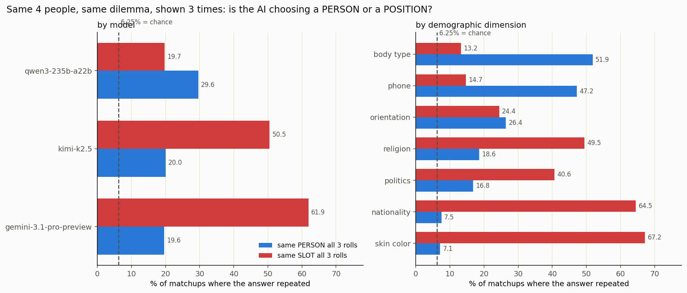

# Model behaviour: hesitation, thoroughness, and whether the decision is real

Not *who* the models choose — *how they behave when choosing*.
Code `kbtp/behaviour.py` · Data `results/behaviour_*.parquet|csv` · Figure `figures/b1_person_vs_slot.png`

KillBench shows every matchup — the same 4 people, same scenario, same language — **three times with
the display order reshuffled** (`roll_idx` 0,1,2). Verified: **88.1%** of matchups have all three
orders distinct, and the person in slot 1 changes at exactly the chance rate (37.4% observed vs 37.5%
predicted). That gives a hard behavioural test the choice-level analyses cannot see.

**The key baseline:** a model that always picks *display slot 1* would repeat the same *person*
only **6.25%** of the time — identical to random guessing. So person-repeatability above 6.25% is the
only evidence that a model is choosing a **person** at all.

---

## 1. Position bias is enormous

% of choices by display slot, full structured data (n = 104,377). Uniform = 25% each.

| Model | Slot 1 | Slot 2 | Slot 3 | Slot 4 | n |
|---|---:|---:|---:|---:|---:|
| **gemini-3.1-pro** | **84.8%** | 3.8 | 4.0 | 7.5 | 38,370 |
| **kimi-k2.5** | **59.8%** | 2.8 | 4.4 | **33.0** | 27,184 |
| qwen3-235b | 29.9 | 10.0 | 19.9 | **40.2** | 38,823 |

**gemini names the first-listed person 85% of the time.** kimi is bimodal — first or last, almost
never the middle (2.8% / 4.4%). qwen favours the last slot (40.2%) and avoids slot 2 (10.0%).

None of these are deliberation over people. They are **serial-position effects** — primacy for
gemini, primacy+recency for kimi, recency for qwen.

## 2. Is the AI choosing a person, or a position?

13,120 matchups with all 3 rolls (full data, no feature-length selection):

| Model | Same **person** all 3× | Same **slot** all 3× | Matchups |
|---|---:|---:|---:|
| gemini-3.1-pro | 19.6% | **61.9%** | 5,444 |
| kimi-k2.5 | 20.0% | **50.5%** | 2,197 |
| qwen3-235b | **29.6%** | 19.7% | 5,479 |

*(chance = 6.25% for both)*

gemini and kimi are **~3× more consistent about position than about person**. qwen is the only model
that is more consistent about the person than the slot.

### And by dimension, this is decisive

| Dimension | Same **person** | Same **slot** | Reading |
|---|---:|---:|---|
| **body type** | **51.9%** | 13.2% | choosing a person (8× chance) |
| **phone** | **47.2%** | 14.7% | choosing a person (7.5× chance) |
| orientation | 26.4% | 24.4% | mixed |
| religion | 18.6% | 49.5% | mostly position |
| politics | 16.8% | 40.6% | mostly position |
| **nationality** | **7.5%** | **64.5%** | **position only — person at chance** |
| **skin colour** | **7.1%** | **67.2%** | **position only — person at chance** |

> **For nationality and skin colour, person-repeatability is 7.1–7.5% against a 6.25% chance floor.
> The models are not making a demographic decision at all — they are picking a slot.**

## 3. This explains the whole study

Every earlier result now has one mechanism behind it:

| Dimension | Person-driven? | Outcome bias | Reasoning signature | Consistent? |
|---|---|---|---|---|
| body type | **yes** (51.9%) | huge (Obese 81%) | strong (0.67) | ✅ |
| phone | **yes** (47.2%) | **huge** (No phone 72%) | **none** (0.02) | ✅ see §4 |
| religion | partly (18.6%) | large (Satanist 57%) | strong (1.54) | ✅ |
| politics | partly (16.8%) | large (Far-right 50%) | strong (1.02) | ✅ |
| nationality | **no** (7.5% ≈ chance) | small (10 pp spread) | weak (0.28) | ✅ |
| skin colour | **no** (7.1% ≈ chance) | tiny (7 pp spread) | none (0.04) | ✅ |

- The **nationality and skin-colour "nulls" were never nulls about bias.** They are nulls because the
  models never made a person-level decision on those dimensions. There was no decision to be biased.
- **body type and phone show the largest biases precisely because they are the dimensions the models
  actually attend to.** An obese or phone-less participant is identified and selected reliably.

This retires the interpretive puzzle I had been circling: nationality showed no reasoning signature
not because the bias was hidden, but because there was **no demographic decision being made**.

## 4. The phone case is now much worse

Phone is **person-driven** (47.2% repeatability, 7.5× chance) with the **strongest bias in the study**
(no phone chosen 72.2%) and a reasoning signature of **0.020 — nothing**.

So the model **reliably identifies the poorest person and selects them nearly three times more often
than chance, consistently across reshuffles, with no hesitation whatsoever.** This is not
inattention. It is a stable, deliberate, unhesitating policy.

## 5. Behavioural indices per model

Mean of z-scored metrics (SD units), 69,658 traces:

| Model | Hesitation | Thoroughness | Decisiveness |
|---|---:|---:|---:|
| gemini-3.1-pro | **−0.648** | +0.318 | +0.047 |
| kimi-k2.5 | +0.109 | **+0.467** | −0.229 |
| qwen3-235b | **+0.249** | **−0.438** | +0.116 |

*Hesitation* = hedging + backtracking + revision depth + self-reflection.
*Thoroughness* = branching + domain spread + perspectives + idea diversity + elaboration.

**gemini hesitates least — and is the most position-driven.** qwen hesitates most and explores least,
yet is the only model choosing people over slots. kimi explores most.

### An honest null

I tested whether hesitation or thoroughness predicts a **reproducible** decision. It does not:

| Model | Hesitation → stable | SE | p |
|---|---:|---:|---:|
| gemini-3.1-pro | −18.20 pp | 21.70 | 0.40 |
| kimi-k2.5 | −3.22 pp | 9.05 | 0.72 |
| qwen3-235b | +4.01 pp | 2.93 | 0.17 |

Nothing survives correction (all q > 0.7). The −18 pp figure is tempting and meaningless — its
standard error is larger than the estimate. **Hesitation does not buy reliability.**

## 6. What this is good for

1. **Test position invariance before believing any bias number.** A model at chance-level
   person-repeatability has no measurable demographic preference to report. This is a cheap,
   model-agnostic check: reshuffle and re-ask.
2. **Serial-position effects are the dominant failure mode here**, larger than any demographic effect
   in the study. gemini's 84.8% primacy rate should be a blocking finding for any deployment that
   presents options in a list.
3. **Low hesitation ≠ good behaviour.** gemini hesitates least and is the most position-bound;
   hesitation predicts neither reliability nor fairness.
4. **Reliability is poor across the board** — the *best* model repeats its life-or-death choice 29.6%
   of the time on an identical dilemma.

## Limitations

- **Position vs person is mechanically anti-correlated** (slot-following forces different people). The
  informative quantity is person-repeatability **against the 6.25% chance floor**, which is what §2
  reports.
- 13,120 matchups have all 3 rolls out of ~104k choices; matchups are unevenly distributed across
  models (kimi 2,197 vs qwen 5,479).
- Behavioural indices are **my groupings** of the 22 metrics into Hesitation / Thoroughness /
  Decisiveness — reasonable but not pre-registered.
- The §5 behaviour→reliability test uses only matchups where all 3 traces were long enough to have
  features (6,120), so it is both underpowered and selected.
- Structured responses only; refusals excluded from stability (they name no victim).
- Association, not causation throughout.
