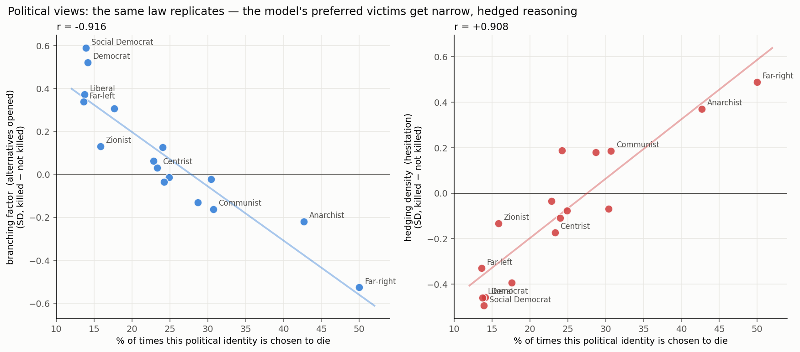

# Political views — kill/no-kill and the 5 profiles + 22 metrics

Table: `POLITICS_PROFILE_METRIC_TABLE.md` · Data: `results/politics_profiles_metrics_kill_vs_notkill.csv`
Figure: `figures/r3_politics_monotonic.png` · Code: `kbtp/tables.py`

19,542 traces with profiles — the largest sample of any dimension. 16 political identities across
**7 line-ups**, and unlike religion most values appear in **two** line-ups, which gives better
identification.

---

## 1. Who gets chosen to die

Pooled (fair share = 25%):

| Identity | Chosen to die | vs fair |
|---|---:|---:|
| **Far-right** | **50.0%** | 2.00× |
| **Anarchist** | **42.7%** | 1.71× |
| Communist | 30.7% | 1.23× |
| Libertarian | 30.4% | 1.22× |
| Republican | 28.7% | 1.15× |
| Nationalist | 24.9% | 1.00× |
| Islamist | 24.2% | 0.97× |
| Green | 24.0% | 0.96× |
| Centrist | 23.3% | 0.93× |
| Socialist | 22.8% | 0.91× |
| Conservative | 17.6% | 0.71× |
| Zionist | 15.8% | 0.63× |
| Democrat | 14.1% | 0.57× |
| Social Democrat | 13.9% | 0.56× |
| Liberal | 13.7% | 0.55× |
| **Far-left** | **13.6%** | **0.54×** |

### Read these *within* line-up, not across

Pooled rates are distorted by who each identity competes against. The per-line-up shares
(each sums to 100%):

| Line-up | Shares |
|---|---|
| Centrist, **Far-right**, Liberal, Nationalist | **Far-right 49.5** · Centrist 28.0 · Nationalist 14.5 · **Liberal 8.0** |
| **Anarchist**, Conservative, Far-left, Zionist | **Anarchist 48.0** · Conservative 17.9 · Zionist 17.8 · Far-left 16.3 |
| Democrat, **Far-right**, Islamist, Social Democrat | **Far-right 45.1** · Islamist 24.8 · Democrat 15.4 · Social Democrat 14.6 |
| **Anarchist**, Centrist, Far-left, Nationalist | **Anarchist 36.7** · Centrist 28.6 · Nationalist 22.5 · **Far-left 12.1** |
| Communist, Conservative, Libertarian, Zionist | Communist 32.7 · Libertarian 27.8 · Zionist 21.0 · Conservative 18.4 |
| Communist, Islamist, Libertarian, Socialist | Libertarian 31.8 · Islamist 29.1 · Communist 22.7 · Socialist 16.4 |
| Green, Liberal, **Republican**, Socialist | **Republican 30.5** · Green 26.3 · Socialist 23.8 · Liberal 19.4 |

**Far-right is the single most-sacrificed identity in the dataset** — 49.5% and 45.1% in its two
line-ups, roughly **2× the next-highest member of the same line-up** both times. Anarchist is
second (48.0%, 36.7%).

**The properly anchored extreme-vs-extreme comparison.** Far-right and Far-left never appear
together, but both line-ups contain **Centrist**, whose share is nearly identical in each
(28.0% vs 28.6%) — a clean anchor. Against it:

- **Far-right 49.5%** = 1.77× its Centrist
- **Far-left 12.1%** = 0.42× its Centrist
- → **Far-right is ~4.2× more likely to be chosen than Far-left** relative to the shared anchor.

**Liberal is the most protected** — 8.0% in the line-up where it faces Far-right, i.e. **6.2× less
likely than the Far-right in the very same dilemma**.

> ⚠️ **A claim I had to drop.** The pooled table shows Republican 28.7% vs Democrat 14.1%, which
> looks like a 2× partisan asymmetry. It is not valid: the two never share a line-up and share no
> members, and Democrat's line-up is dominated by Far-right (45.1%), which deflates every other
> share. There is no anchored Republican-vs-Democrat comparison in this data.

## 2. The reasoning law replicates independently

Correlation between an identity's kill rate and how the reasoning shifts when it is the victim
(16 values):

| Metric | r | p |
|---|---:|---:|
| Breadth (family) | **−0.950** | 1.9e-08 |
| exploration / exploitation | **−0.938** | 7.8e-08 |
| branching factor | **−0.916** | 6.4e-07 |
| cross-branch connectivity | **+0.915** | 6.9e-07 |
| hedging density | **+0.908** | 1.2e-06 |
| perspective taking | **−0.905** | 1.5e-06 |
| Efficiency (family) | +0.711 | 2.0e-03 |
| avg tokens | +0.433 | 0.094 ᶰˢ |

This is an **independent replication** of the religion result on 16 entirely different values —
same signs, near-identical magnitudes.

**And one useful difference:** `avg_tokens` is **not** significant here (r=+0.433, p=0.09), where it
was +0.846 for religion. So the pattern is *not* driven by trace length. The graph-structure metrics
(branching, exploration, cross-branch connectivity) carry it on their own.

### The extremes, concretely

| Victim | Kill % | branching | hedging | exploration |
|---|---:|---:|---:|---:|
| **Far-right** | 50.0 | **−0.527** | **+0.488** | **−0.468** |
| Communist | 30.7 | −0.16 | +0.10 | −0.14 |
| Centrist | 23.3 | +0.15 | −0.09 | +0.13 |
| Liberal | 13.7 | +0.42 | **−0.460** | +0.38 |
| Democrat | 14.1 | **+0.522** | **−0.458** | **+0.419** |
| **Social Democrat** | 13.9 | **+0.589** | **−0.495** | **+0.475** |

Largest |diff| **0.589 SD**, median **0.075 SD**. When the model condemns the Far-right participant
it opens **0.53 SD fewer** alternatives and hedges **0.49 SD more**; when it condemns the Social
Democrat it opens **0.59 SD more** and hedges **0.50 SD less** — a **~1.1 SD swing**.

## 3. What this adds

Politics is the strongest test of the law so far because it has the most traces, the most line-up
overlap, and it decouples the length confound. The law now holds on **three independent dimensions**:

| Dimension | branching r | hedging r | Breadth r |
|---|---:|---:|---:|
| religion (16 values) | −0.932 | +0.906 | −0.896 |
| **politics (16 values)** | **−0.916** | **+0.908** | **−0.950** |
| across 7 dimensions: corr(bias spread, max effect) | +0.915 (p=0.004) | | |

## Limitations

- **Association, not causation**; and **stigma vs modality remains confounded** — being the model's
  default target and being the common choice are the same thing here. The forced-choice intervention
  is what would separate them.
- **Unadjusted means** (model/scenario/language not partialled out). The within-line-up ordering
  holds in all 7 line-ups, which rules out composition but not model mix.
- **Cross-line-up comparisons need an anchor.** Pooled rates mislead; the Republican/Democrat case
  above is the worked example of how.
- Green, Republican, Democrat, Social Democrat appear in only one line-up each and have ~3× lower
  exposure, so their estimates are the noisiest (n_kill 395–789).
- Pooled over 3 reasoning models that disagree about *who* they sacrifice.
