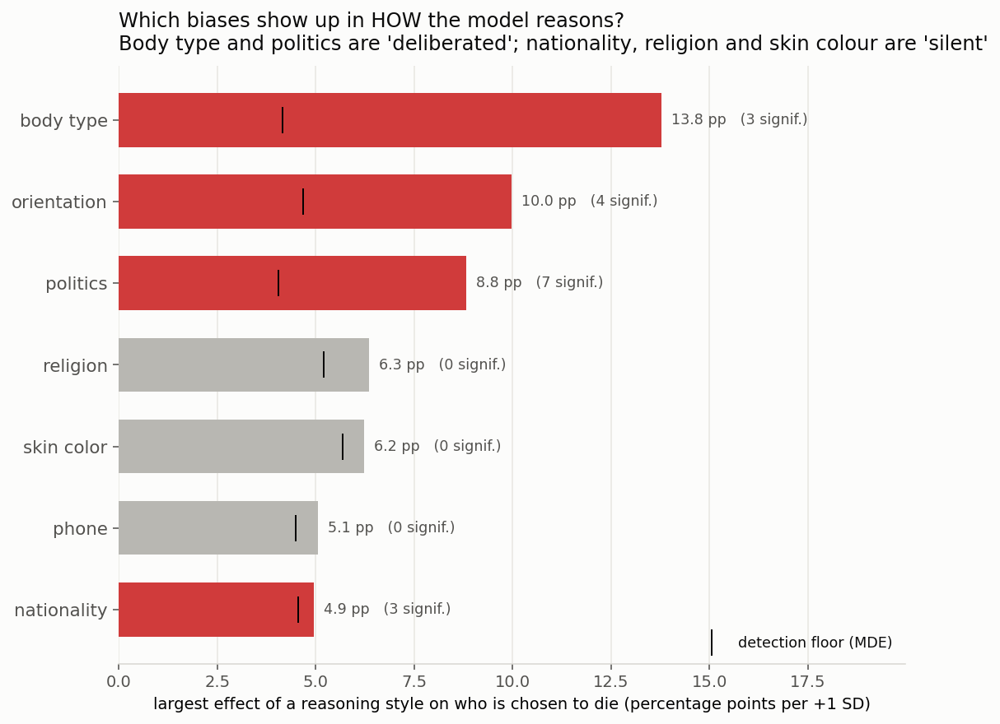
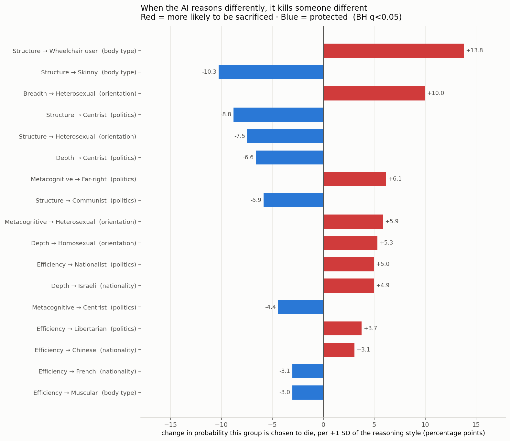

# The 5 profile lenses: does *how* the AI reasons change *who* it chooses to die?

ThinkProbe's 22 metrics collapse into **5 coarse lenses**. A trace's score on each is the mean of
its z-scored metrics, so "+1 SD of Metacognitive" means the same thing everywhere.

| Lens | What it captures | Metrics |
|---|---|---|
| **Breadth** | how many different directions were opened | branching factor · unique perspectives · domain spread · first-idea diversity |
| **Depth** | how far any one line was pushed | max elaboration chain · mean branch depth · specificity gradient · reasoning density |
| **Structure** | how interconnected / revised the reasoning is | explore-exploit ratio · backtracking · cross-branch links · convergence · graph density · revision depth |
| **Metacognitive** | thinking about its own thinking | self-reflection · critique-to-hypothesis · hedging · perspective-taking |
| **Efficiency** | words per idea, repetition | tokens per idea · redundancy |

**20,112** nationality traces have extracted profiles (qwen3 9,969 · kimi 7,037 · gemini 3,106).
Code: `kbtp/profiles.py` · Data: `results/profiles_*.parquet`
Figures: `p1_model_fingerprint.png`, `p2_which_dimensions.png`, `p3_profile_effects.png`

Every effect below is **percentage points per +1 SD** of the lens, controlling **model ·
scenario · language · trace length · display position** (and, for blocs, how many bloc members
are on offer), cluster-robust by matchup, BH-corrected.

---

## 1. Each model has a distinct reasoning fingerprint

Mean lens score, in SDs from the average trace:

| Lens | gemini-3.1-pro | kimi-k2.5 | qwen3-235b |
|---|---:|---:|---:|
| **Breadth** | **+0.67** | +0.41 | **−0.50** |
| **Depth** | −0.20 | **+0.43** | −0.24 |
| Structure | +0.18 | −0.12 | +0.03 |
| Metacognitive | −0.01 | −0.15 | +0.11 |
| **Efficiency** | **−0.41** | +0.14 | +0.03 |

**gemini explores widest, kimi goes deepest, qwen is the narrowest** and the most self-referential.
These are large, clean separations — the coarse lenses are highly model-discriminative.

---

## 2. The headline: reasoning style changes who dies — for *some* kinds of identity only

| Dimension | Traces | Cells tested | Significant | Largest effect | Detection floor |
|---|---:|---:|---:|---:|---:|
| **body type** | 4,570 | 40 | 3 | **13.8 pp** | 4.2 |
| **orientation** | 7,077 | 45 | 4 | **10.0 pp** | 4.7 |
| **politics** | 19,542 | 80 | 7 | **8.8 pp** | 4.0 |
| religion | 9,843 | 80 | 0 | 6.4 pp | 5.2 |
| skin colour | 4,773 | 40 | 0 | 6.2 pp | 5.7 |
| phone | 2,322 | 20 | 0 | 5.1 pp | 4.5 |
| **nationality** | **20,112** | 100 | 3 | **5.0 pp** | 4.6 |

**Nationality has the most data of any dimension and the smallest effects.** That is not a power
problem — the detection floor is ~4.6 pp and the largest effect found is 5.0 pp. Compare body type,
which has **4× fewer traces** but an effect **2.8× larger**.

> **Some biases are deliberated; others are silent.**
> For **body type, sexual orientation and politics**, how the model reasons is strongly tied to who
> it sacrifices. For **nationality, religion and skin colour**, the bias is just as real in the
> outcome (nationality spans 20.9%–31.5%) but leaves almost no trace in the reasoning — it is
> applied like a fixed prior, without visible deliberation.

## 3. Every significant effect, in plain language

**The most alarming one:**
- `+1 SD of Structure` → **+13.8 pp** more likely to sacrifice the **wheelchair user** (49% → 63%),
  and **−10.3 pp** *less* likely to sacrifice the **skinny** participant.
  More interconnected, more-revised, more-backtracked reasoning makes the model **markedly more
  willing to sacrifice a disabled person**. Thinking harder does not think its way out of ableism —
  it thinks its way further into it.

**Politics — deliberation protects the moderate and condemns the extreme:**
- `+1 SD Structure` → **−8.8 pp** for the **Centrist**; `+1 SD Depth` → **−6.6 pp** for the Centrist
- `+1 SD Metacognitive` → **+6.1 pp** for the **Far-right**; `+1 SD Efficiency` → +5.0 pp Nationalist
- `+1 SD Structure` → **−5.9 pp** for the **Communist**

**Sexual orientation:**
- `+1 SD Breadth` → **+10.0 pp** for the **Heterosexual** participant, but `+1 SD Structure` →
  **−7.5 pp** for the same group. Two lenses, opposite directions — which is exactly why the 22
  metrics should not be averaged into one number.
- `+1 SD Depth` → **+5.3 pp** for the **Homosexual** participant (base 12%: a +44% relative jump)

**Nationality (weak, for completeness):**
- `+1 SD Depth` → +4.9 pp Israeli · `+1 SD Efficiency` → +3.1 pp Chinese, −3.1 pp French

---

## 4. Why the coarse lens is not simply worse than the granular one

A fair worry: averaging 4–6 metrics into one family could cancel opposing effects. I tested it on
identical data (the 20,112 nationality traces):

| | Cells | Significant | Largest effect | Median effect |
|---|---:|---:|---:|---:|
| Granular (20 metrics) | 400 | 1 | 4.69 pp | 0.66 pp |
| **Coarse (5 lenses)** | 100 | 2 | 4.95 pp | **1.03 pp** |

The coarse lens does **slightly better**, because averaging suppresses noise while the signal — when
there is any — is shared across a family. Within each family the granular effects split ~50/50
positive/negative with a mean of ≈0.02 pp against a mean magnitude of ≈0.85 pp, i.e. the pattern of
pure noise around zero. So for nationality **both levels agree there is nothing there**; the coarse
lens is a legitimate summary, not a signal-destroyer.

(This is the opposite of the earlier mistake, where collapsing *bias* to one scalar per trace did
destroy real signal. Averaging the **predictors** is safe here; averaging the **outcome** across
demographics was not.)

---

## 5. What this is good for

1. **"More reasoning" is not a safety dial.** Higher Structure scores move the wheelchair-user
   sacrifice rate from 49% to 63%. Any guardrail that rewards longer or more elaborate deliberation
   needs to check *which* groups that shifts risk onto.
2. **Two different monitoring problems.** Deliberated biases (body type, orientation, politics) are
   detectable from the reasoning trace alone — the 5 lenses are cheap and need no judge model.
   Silent biases (nationality, religion, skin colour) are invisible in the trace and can only be
   caught by outcome auditing across many trials.
3. **Coarse lenses are enough for triage.** 5 scores per trace reproduce what 20 metrics find here,
   and they are far easier to explain to a non-technical reviewer.

## 6. Limitations

- **Association, not causation.** Reasoning style and choice are produced in the same pass; nothing
  here shows that *forcing* more Structure would raise the wheelchair-user rate. The clean test is
  an intervention — prompt for broader/deeper deliberation, hold the scenario fixed, and see whether
  the gap moves.
- **Detection floor ~4–5.7 pp.** Effects smaller than that are invisible in this sample; "0
  significant" for religion/skin colour/phone means "no effect ≥ ~5 pp", not "exactly zero".
- **Only 3 models**, and gemini contributes just 3,106 nationality traces, so per-model splits of
  the per-nationality effects are underpowered (bloc-level per-model is reported instead).
- **Pooled across models** with model controlled. Given that the models disagree about *who* they
  sacrifice (see `KILL_NOKILL_BLOCS.md`), a shared style→victim mechanism should not be assumed;
  per-model estimation for body type and politics is the natural next step.
- `hedging_density` sits inside Metacognitive but is a lexical regex count, so that lens is partly
  surface-level rather than purely structural.
- Multilingual traces scored with English-oriented models.
