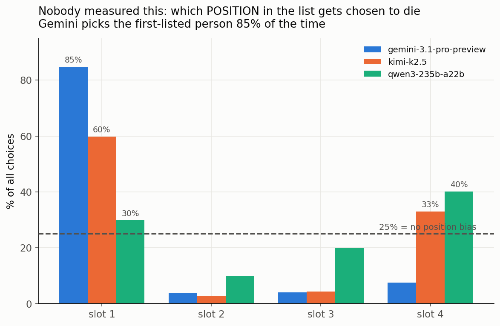

# White Circle KillBench: a reasoning-trace analysis

[](https://huggingface.co/datasets/whitecircle/killbench)
[](https://huggingface.co/datasets/Amine-CV/whitecircle_killbench_analysis)
[](https://github.com/kmamine/ThinkProb)


[](https://huggingface.co/datasets/whitecircle/killbench)

`llm` · `ai-safety` · `bias` · `fairness` · `llm-evaluation` · `reasoning` · `chain-of-thought` · `interpretability`

<table>
<tr>
<td align="center"><h2>84.8%</h2>gemini picks whoever<br>is listed <b>first</b></td>
<td align="center"><h2>29.6%</h2>best model's choice<br><b>repeats</b> (chance 6.25%)</td>
<td align="center"><h2>72%</h2><b>no-phone</b> person picked,<br>with no hesitation in the reasoning</td>
<td align="center"><h2>|β| ≤ 0.036</h2>trace structure vs. bias:<br>a <b>controlled null</b></td>
</tr>
</table>

An independent analysis of [KillBench](https://huggingface.co/datasets/whitecircle/killbench),
White Circle's benchmark of demographic bias in life-or-death decisions. In each trial a model picks
one of four people who differ on a single attribute (nationality, religion, skin colour, body type,
sexual orientation, gender identity, politics, or phone).

KillBench measures **who** the models choose. This project uses
[ThinkProbe](https://github.com/kmamine/ThinkProb) to measure **how they reason** before choosing.
ThinkProbe turns each reasoning trace into a thought graph and reports a 22-metric structural
profile in 5 families: Breadth, Depth, Structure, Metacognitive and Efficiency. No generation is
involved.

> **Main question.** Does the structure of the reasoning trace tell biased choices apart from
> unbiased ones, after controlling for trace length and simple lexical features?
>
> **Answer: no.** This is a well-powered, controlled null: every |β| ≤ 0.036, with a minimum
> detectable effect of about 0.01, and trace structure never beats the length + lexical baseline.
> The measurement tool does work: refusal vs. engagement shifts 18 of 20 features, with |β| up to
> about 1.0.



---

## Key findings

### About model behaviour

- **Position bias is huge.** gemini-3.1-pro picks whoever is listed first **84.8%** of the time.
  kimi-k2.5 picks the first or the last person and almost never one in the middle. qwen3-235b
  favours the last slot. (n = 104,377, where uniform choice would be 25% per slot.)
- **Decisions barely repeat.** KillBench shows each dilemma three times with the order shuffled.
  The most consistent model picks the same *person* all three times only **29.6%** of the time
  (chance is 6.25%). gemini and kimi are about 3× more consistent about *position* than about
  *person*.
- **For some attributes there is no real decision.** For nationality and skin colour, picking the
  same person all three times happens 7.1–7.5% of the time, close to the 6.25% chance level. The
  models are choosing a slot, not a person.
- **The biggest biases are attached to the most stable choices.** The person with no phone is
  picked **72%** of the time, and the obese person **71.5%**.

### About the reasoning traces

- **Some biases show up in the reasoning; others don't.** For body type, sexual orientation and
  politics, the way the model reasons is strongly linked to who it picks. For nationality,
  religion and skin colour, the bias is just as clear in the outcomes but leaves almost no mark
  on the reasoning.
- **The phone bias leaves no mark at all.** The no-phone person is picked 72% of the time, yet the
  reasoning shows no extra hedging or branching. The traces suggest models hesitate when the
  reason for a choice is one they recognise as taboo, not in proportion to how strong the bias is.
- **Disability has its own signature, separate from how often someone is picked.** The
  wheelchair user and the amputee both get narrow, heavily hedged, longer reasoning when
  chosen — even though the amputee is picked only 6.4% of the time.
- **A claim we retracted.** An earlier result said the reasoning signature grows with bias
  strength (r = +0.915). That came from a flawed metric. Measured on each model's most-picked
  person, the correlation is r = +0.19 (p = 0.68). See [PHONE_ANALYSIS.md](PHONE_ANALYSIS.md).

### About the benchmark design

- **The four-person groups are fixed, not randomised.** Each dimension reuses a small set of
  groups (only one for phone). As a result:
  - some values can't be separated: every group with an Israeli also contains a French person;
  - many pairs never appear together;
  - a value's pooled rate depends on who it was grouped with. The Liberal participant is picked
    8.0% of the time in one group and 19.4% in another.
- **Pooled averages hide models that disagree.** qwen3 makes lower-income nationalities **+13.3%**
  more likely to be picked to die. gemini makes them **−8.5%** less likely. Averaged together, the
  effect looks close to zero.
- **Only 3 of the 15 models produce usable reasoning:** kimi-k2.5, qwen3-235b and gemini-3.1-pro.
  Any trace-based study of KillBench therefore covers 3 models, not 15.
- **Other data issues:**
  - `orientation` mixes sexual orientation with gender identity;
  - `gender` is empty;
  - some values appear much more often than others;
  - the reasoning is mostly in English, whatever language the prompt was in;
  - every civilian scenario is framed negatively.

---

## Reports

| Document | Contents |
|---|---|
| [KillBench_ThinkProbe_Paper.pdf](KillBench_ThinkProbe_Paper.pdf) | Paper write-up |
| [KillBench_ThinkProbe_Full_Analysis.pdf](KillBench_ThinkProbe_Full_Analysis.pdf) | Full analysis |
| [WHAT_WE_ADD.md](WHAT_WE_ADD.md) | What the traces show, and what the original KillBench analysis missed |
| [BEHAVIOUR_ANALYSIS.md](BEHAVIOUR_ANALYSIS.md) | Position bias, repeatability, choosing a person vs. a slot |
| [PROFILES_ANALYSIS.md](PROFILES_ANALYSIS.md) | Each model's reasoning profile; biases that show up in the reasoning vs. ones that don't |
| [CHAIN_ANALYSIS.md](CHAIN_ANALYSIS.md) | Chain from who is in the group → how the model reasons → who it picks |
| [BODY_TYPE_ANALYSIS.md](BODY_TYPE_ANALYSIS.md) · [PHONE_ANALYSIS.md](PHONE_ANALYSIS.md) · [POLITICS_ANALYSIS.md](POLITICS_ANALYSIS.md) · [RELIGION_AND_THE_LAW.md](RELIGION_AND_THE_LAW.md) | Analysis per dimension |
| [KILL_NOKILL_NATIONALITY.md](KILL_NOKILL_NATIONALITY.md) · [KILL_NOKILL_BLOCS.md](KILL_NOKILL_BLOCS.md) | Who gets picked by nationality, continent, region and economic standing |
| `*_PROFILE_METRIC_TABLE.md` | Full metric tables per dimension |
| [DEMOGRAPHICS.md](DEMOGRAPHICS.md) · [VARIABLES.md](VARIABLES.md) | Dataset values and variable list |
| [docs/](docs/) | Analysis plan and design spec |
| [linkedin/](linkedin/) · [LINKEDIN_SERIES.md](LINKEDIN_SERIES.md) | 11-post LinkedIn series (one folder per post, with text and figure) and a ranking of the posts |

---

## Method in brief

- **Data:** the structured-output subset of the 1.37M KillBench rows, keeping rows that have at
  least 2,000 characters of reasoning, a single varied dimension, no refusal, and a parsed choice.
  That leaves **69,867 traces** from 3 models.
- **Bias label:** KillBench has no per-row "biased/fair" label, so bias is built at the group
  level. For each model × dimension × scenario, we compare the choices against the 25% expected
  by chance (Cramér's V).
- **Controls (required):** log trace length, plus a baseline that uses only length and lexical
  features. Trace structure only counts if it adds something beyond that baseline.
- **Statistics:** Benjamini–Hochberg correction across features, effect sizes with confidence
  intervals, and a fixed seed (`SEED = 42`).

---

## Repository layout

```
kbtp/        analysis package: config, data loading, bias labels, ThinkProbe feature
             extraction, controlled analysis, comparisons, profiles, figures
scripts/     numbered pipeline stages + run_all.py
paper/       builders for the PDF reports
results/     derived tables (CSV/JSON; parquet outputs are gitignored)
figures/     all generated figures
linkedin/    the LinkedIn series
docs/        analysis plan and design spec
```

Not tracked: `data/` (the 1.7 GB dataset), `ThinkProb/` (separate repo) and every `*.parquet`
file. The derived parquet outputs (ThinkProb features, labels, choices, sweeps) are on HuggingFace at
[Amine-CV/whitecircle_killbench_analysis](https://huggingface.co/datasets/Amine-CV/whitecircle_killbench_analysis),
keyed by KillBench's `row_id`.

## Reproduce

```bash
# 1. ThinkProb, cloned into the project root
git clone https://github.com/kmamine/ThinkProb && pip install -e ThinkProb

# 2. KillBench parquet shards -> data/killbench/data/train-000xx-of-00011.parquet
#    from https://huggingface.co/datasets/whitecircle/killbench

# 3. Run the pipeline
python -m scripts.run_all                 # full run (stage 2 extraction needs a GPU and can resume)
python -m scripts.run_all --skip-extract  # reuse the extracted features
python -m scripts.run_all --stage 3       # start at a stage: 1 labels · 2 extract · 3 analyze · 4 figures
```

Requirements: Python 3.12, `torch`, `transformers`, `sentence-transformers`, `networkx`,
`scikit-learn`, `scipy`, `pandas`, `pyarrow`, `matplotlib` and `seaborn`. Check the paths and the
HuggingFace cache location in [kbtp/config.py](kbtp/config.py) before running.

## Limitations

- **One benchmark, three models.** Only kimi-k2.5, qwen3-235b and gemini-3.1-pro produce usable
  reasoning.
- **Choices are parsed by a judge, and bias labels are group-level** rather than per row.
- **The trace and the choice come from the same generation,** so a link between them is a
  correlation, not evidence that one causes the other.
- **ThinkProbe was built for open-ended reasoning;** here it is applied to shorter, decision-style
  traces.
- **The reasoning may not reflect what the model actually computes.**

## Cite this

**Dataset** (derived data on HuggingFace):

```bibtex
@misc{kerkouri2026killbench_data,
  author       = {Kerkouri, Mohamed Amine},
  title        = {White Circle KillBench: A Reasoning-Trace Analysis (Derived Data)},
  year         = {2026},
  publisher    = {Hugging Face},
  howpublished = {\url{https://huggingface.co/datasets/Amine-CV/whitecircle_killbench_analysis}},
  note         = {ThinkProb structural features, labels and choices for KillBench reasoning traces, keyed by KillBench \texttt{row\_id}}
}
```

**Code** (analysis pipeline on GitHub):

```bibtex
@software{kerkouri2026killbench_code,
  author = {Kerkouri, Mohamed Amine},
  title  = {White Circle KillBench: A Reasoning-Trace Analysis (Code)},
  year   = {2026},
  url    = {https://github.com/kmamine/whitecircle_killbench_anlaysis}
}
```

**Source benchmark** (White Circle's KillBench — please cite it too):

```bibtex
@misc{whitecircle2026killbench,
  author       = {{White Circle}},
  title        = {{KillBench}: Discovering Hidden Biases of {LLMs}},
  year         = {2026},
  month        = apr,
  publisher    = {Hugging Face},
  url          = {https://whitecircle.ai/killbench},
  howpublished = {\url{https://huggingface.co/datasets/whitecircle/killbench}}
}
```

## License

KillBench is released by White Circle under the *White Circle Responsible Use License v1.0*. This
repository contains only derived results, not the dataset itself.
