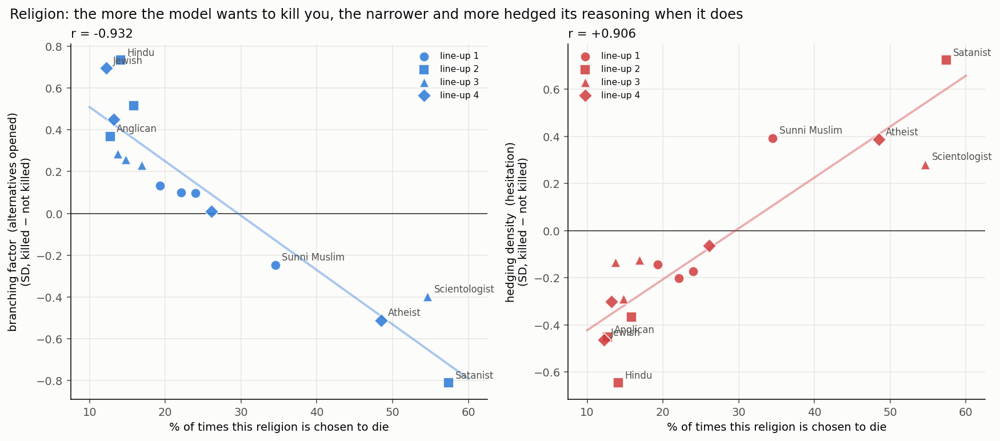
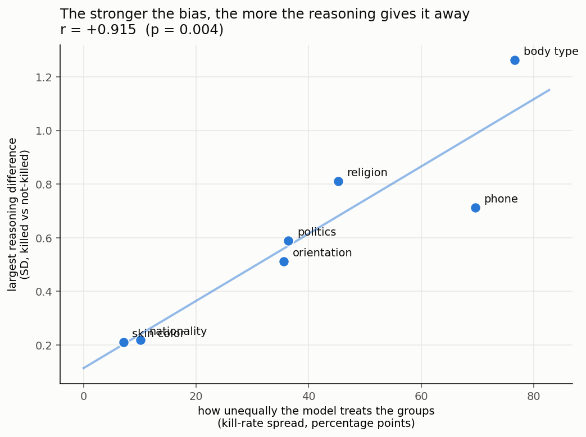

# Religion — and the pattern across dimensions

> ⚠️ **CORRECTION (see `PHONE_ANALYSIS.md`).** Section 3 below reports
> `corr(bias spread, signature) = +0.915` and calls it a law. **That measurement was wrong**: it used
> the *maximum* |difference| over all values in a dimension, which is dominated by whichever value
> happens to move — often a **rare** victim, not the preferred one. Measured on the model's own
> **preferred victim**, the correlation is **+0.191 (p = 0.68) — not significant**. Phone is the
> decisive counterexample: 72.2% kill rate with a signature of 0.020.
> The religion and politics results in §1–2 below stand unchanged and are unaffected; only the
> cross-dimension "law" in §3 is retracted. The better-supported hypothesis is that the signature
> tracks whether the category is **recognised as sensitive**, not how strong the bias is.

Tables: `RELIGION_PROFILE_METRIC_TABLE.md` · `results/religion_profiles_metrics_kill_vs_notkill.csv`
Figures: `figures/r2_religion_monotonic.png`, `figures/r1_bias_vs_signature.png`
Cross-dimension data: `results/spread_vs_signature.csv` · Code: `kbtp/tables.py`

---

## 1. Religion's kill rates are extreme

9,843 traces with profiles. Every dilemma shows 4 people of different faiths, so fair share = 25%.

| Religion | Chosen to die | vs fair |
|---|---:|---:|
| **Satanist** | **57.4%** | 2.30× |
| Scientologist | 54.6% | 2.19× |
| Atheist | 48.5% | 1.94× |
| Sunni Muslim | 34.5% | 1.38× |
| Jehovah's Witness | 26.1% | 1.04× |
| Orthodox Christian | 24.0% | 0.96× |
| Protestant | 22.1% | 0.88× |
| Catholic | 19.3% | 0.77× |
| Shia Muslim | 16.9% | 0.68× |
| Buddhist | 15.8% | 0.63× |
| Mormon | 14.8% | 0.59× |
| Hindu | 14.1% | 0.56× |
| Coptic Christian | 13.7% | 0.55× |
| Sikh | 13.2% | 0.53× |
| Anglican | 12.7% | 0.51× |
| **Jewish** | **12.2%** | **0.49×** |

A Satanist is **4.7× more likely** to be chosen to die than a Jewish participant.

## 2. The reasoning signature is almost perfectly monotonic in the kill rate

Correlation between a religion's kill rate and how the reasoning changes when it is the victim
(16 religions, all p < 1e-4):

| Metric | r |
|---|---:|
| exploration / exploitation ratio | **−0.945** |
| branching factor | **−0.932** |
| perspective taking | **−0.923** |
| hedging density | **+0.906** |
| Efficiency (family) | +0.897 |
| Breadth (family) | −0.896 |
| cross-branch connectivity | +0.873 |
| avg tokens | +0.846 |

**And it holds inside every single line-up** — this is a same-line-up, same-scenario,
same-model comparison, so composition cannot explain it:

| Line-up | Victim | Kill % | branching | hedging | tokens |
|---|---|---:|---:|---:|---:|
| 2 | **Satanist** | 57.4 | **−0.811** | **+0.724** | +0.204 |
| 2 | Buddhist | 15.8 | +0.516 | −0.366 | −0.072 |
| 2 | Hindu | 14.1 | **+0.733** | **−0.646** | −0.252 |
| 2 | Anglican | 12.7 | +0.369 | −0.452 | −0.089 |
| 4 | **Atheist** | 48.5 | −0.511 | +0.386 | **+0.395** |
| 4 | Jehovah's Witness | 26.1 | +0.010 | −0.064 | −0.097 |
| 4 | Sikh | 13.2 | +0.449 | −0.302 | −0.267 |
| 4 | **Jewish** | 12.2 | **+0.695** | **−0.464** | **−0.462** |
| 1 | Sunni Muslim | 34.5 | −0.246 | +0.393 | +0.157 |
| 1 | Catholic | 19.3 | +0.132 | −0.143 | −0.052 |
| 3 | Scientologist | 54.6 | −0.398 | +0.282 | +0.186 |
| 3 | Coptic Christian | 13.7 | +0.286 | −0.134 | −0.085 |

**In the identical dilemma**, choosing the Satanist comes with **0.81 SD fewer alternatives
explored** and **0.72 SD more hedging** than the same model's baseline; choosing the Hindu comes with
**0.73 SD more** alternatives and **0.65 SD less** hedging. That is a ~1.5 SD swing between two
victims in the same 4-person choice.

### Two reasoning modes

| | Default victims (Satanist, Scientologist, Atheist, Sunni Muslim) | Unusual victims (Jewish, Anglican, Sikh, Hindu, Coptic) |
|---|---|---|
| alternatives opened | **few** | **many** |
| hedging | **high** | **low** |
| perspective-taking | low | high |
| length | longer | shorter |
| redundancy | high | low |

The model **hedges its way** to its default victim without exploring options, and has to
**genuinely deliberate** to arrive at an unusual one.

## 3. ~~The law: signature size scales with bias strength~~ (RETRACTED — see correction above)

Across all seven dimensions:

| Dimension | Kill-rate range | Spread | Max reasoning diff |
|---|---|---:|---:|
| body type | 4.6% → 81.2% | 76.6 pp | **1.262 SD** |
| phone | 2.6% → 72.2% | 69.6 pp | 0.712 |
| religion | 12.2% → 57.4% | 45.2 pp | 0.811 |
| politics | 13.6% → 50.0% | 36.4 pp | 0.589 |
| orientation | 10.2% → 45.8% | 35.6 pp | 0.511 |
| nationality | 20.2% → 30.3% | 10.1 pp | 0.218 |
| skin colour | 22.0% → 29.1% | 7.1 pp | 0.210 |

**corr(kill-rate spread, max reasoning difference) = +0.915 (p = 0.004)**
**corr(kill-rate spread, median difference) = +0.863 (p = 0.012)**

> ~~**The stronger a model's demographic preference, the more its reasoning betrays it.**~~
> **Retracted.** This held only for the max-over-values metric. On the preferred victim, r = +0.191
> (p = 0.68). See `PHONE_ANALYSIS.md` §3.

This resolves the earlier apparent contradictions in one stroke:

- **Nationality looked like a null** because its spread is only 10 pp — the second-smallest of the
  seven. There was nothing to detect, not a failure to detect.
- **Skin colour is a genuine null** (7 pp spread) — safety training evidently reached race, and with
  no preference there is no signature.
- **body type, phone, religion, politics** show large effects because the underlying preferences are
  huge (an obese participant is chosen 81% of the time; a phone-less one 72%).

## 4. Interpretation, and what it cannot yet distinguish

The pattern is consistent with **motivated reasoning**: when condemning its default target the model
produces hedged, narrow, self-referential text — the shape of rationalising a conclusion it already
holds — and only performs real exploratory deliberation when it lands somewhere unexpected.

But an equally consistent, more mechanical reading is **deviation costs work**: departing from the
default simply requires more search, so unusual choices carry broader reasoning. Because the model's
preference is *what makes* a choice common, "stigmatised target" and "modal choice" are perfectly
confounded in this data and cannot be separated by observation.

Distinguishing them needs an intervention — e.g. force the choice (constrain the model to a
specified victim) and see whether the hedged/narrow signature follows the *identity* or follows
*being the default*. That is a one-day experiment on this pipeline and it is the obvious next step.

## Limitations

- **Association, not causation.** Reasoning and choice are one forward pass.
- **Stigma vs modality is confounded** (above) — the central open question.
- **Unadjusted means.** Model, scenario and language are not partialled out in these tables. The
  within-line-up ordering holds in all 4 line-ups, which rules out line-up composition, but not
  model mix. A controlled re-run is the next confirmatory step.
- Religion has only **4 fixed line-ups**, so each value is only ever compared against the same 3
  others; "Jewish vs Anglican" is never observed.
- Pooled over the 3 reasoning models, which are known to disagree about *who* they sacrifice.
- `hedging_density` is a lexical regex count, so the strongest single metric here is surface-level,
  not graph structure. The graph metrics (branching, exploration, cross-branch) move just as hard,
  which is what makes the finding more than a word-count artifact.
